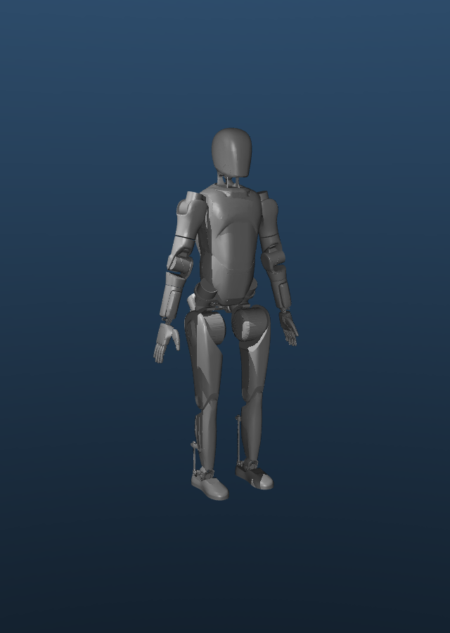

# Luka A2 Ultra — estimated 3D model



This repository contains a **MuJoCo model candidate** for Luka, a full-size AgiBot A2 Ultra. The render above is generated from the model. It is **not** a 3D scan of Luka, a record of his damaged surfaces, or a model validated against his physical motion.

Open [`build/luka_as_is.xml`](build/luka_as_is.xml) in MuJoCo to load the assembled model. Keep the `build/` and `vendor/agibot_a2/` directories in their current relative positions: the XML references the mesh files there.

## What is in this repository

- `build/luka_as_is.xml` — generated, readable MuJoCo model; its numeric values are rounded by MuJoCo's XML writer.
- `build/luka_as_is.report.md` — build status, estimates, gaps, and missing actuation.
- `vendor/agibot_a2/` — unchanged public AgiBot model inputs: URDF, MJCF, 48 visual meshes, 47 collision meshes, source provenance, SHA-256 checksums, and the Mulan PSL v2 license copy.
- `model/ledger.csv` — parameter values with units, source, date, evidence, and active/missing status. `model/measurements.csv` records vendor reference values and leaves Luka measurements blank.
- `model/build_twin.py` and `tools/` — scripts used to build and inspect the model. `SOURCE_MANIFEST.json` records the exported files' hashes.
- `data/ipad-playback/` — three joint-only playback recordings copied from the paired iPad Air's Luka app, with byte counts and hashes. They are example observations, not model calibration or physical validation.

The vendor files came from [`Link-U-OS/rl_training`](https://github.com/Link-U-OS/rl_training) at commit `8bf8fd8bbcc38d09731d1b15f894ce7388b08c3d`; see [`vendor/agibot_a2/PROVENANCE.md`](vendor/agibot_a2/PROVENANCE.md) and [`LICENSE-MulanPSL2`](vendor/agibot_a2/LICENSE-MulanPSL2). The source model is an A2 T2D0 candidate. Luka's robot software reported `A2_T3D1_FLAGSHIP`; compatibility has **not** been established by physical measurement.

## Current validation boundary

The checked XML compiled locally in MuJoCo 3.17.0 with 50 bodies, 28 joints, 12 actuators, and a fixed base. The build report identifies **100 estimated parameter values**, **84 dynamics gaps** represented as zero, and **16 arm/head joints without actuators**. These are software/model observations, not verified Luka properties. No physical telemetry replay or independent geometry measurements validate this twin against Luka.

The generated 69 MB `.mjb` is omitted from Git history. It can be rebuilt from the ledger and vendor files; the XML in this repository is immediately loadable. The binary preserves the ledger's numeric precision, while MuJoCo rounds the XML representation.

## Load and rebuild

On a Mac with Python 3, from the repository root:

```sh
python3 -m venv .venv
.venv/bin/python -m pip install -r requirements-sim.txt
.venv/bin/python -I tools/mj_inspect.py build/luka_as_is.xml
.venv/bin/python -I model/build_twin.py --out build/rebuilt.xml
```

To check the byte-preserved vendor input files:

```sh
cd vendor/agibot_a2
shasum -a 256 -c SHA256SUMS
```

The render is an illustration of the XML's zero pose. It does not show Luka's as-received condition or prove a physical capability.

## iPad data scope

The public recordings contain only the `a2remote/joints` playback topic. The Luka app also held a room map and live recordings containing camera, depth, and LiDAR streams; these are kept in a separate private backup. The iPad figure's onboard-derived model meshes are also kept private because their source files state no redistribution license. See [`data/ipad-playback/README.md`](data/ipad-playback/README.md) for the public subset's provenance and limits.
